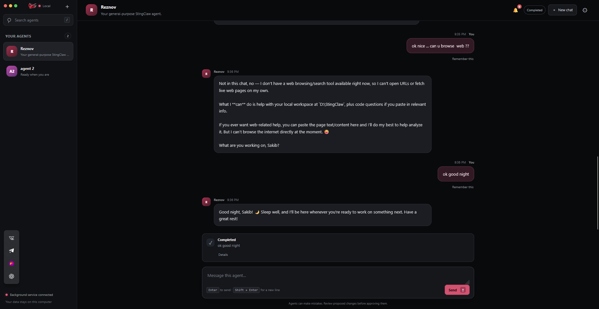

# StingClaw

StingClaw is a Windows app for using named AI agents with your files and code. Chat from the local web app or Telegram, choose what each agent can do, and review file or command changes before they are applied.

This guide describes features in the current app.

## What you can do

- Create agents with their own name, description, instructions, model, API keys, and permissions.
- Chat with agents and keep separate conversations for different work.
- Use **Ask**, **Plan**, and **Agent** modes from the terminal. Telegram also supports `/ask`, `/plan`, and `/agent`.
- Let an agent read and search project files, analyze a codebase, and use enabled tools such as file changes or shell commands.
- Review proposed file and shell changes. See the diff, then approve or reject them.
- Search and read public web pages when you add a Firecrawl key and allow web access for an agent.
- Connect more than one OpenRouter key to an agent. StingClaw can try the next key after certain provider errors.
- Use Telegram to message your saved agents, follow task progress, and review proposed changes.
- Save agent memories, create daily or weekly jobs, and receive task notifications.
- Keep work running after closing the browser, as long as the StingClaw service and your computer stay on.

## The web interface



The screenshot shows the main chat screen:

- **Left sidebar:** search for agents, choose an agent, create one with **+**, and reopen recent chats.
- **Top bar:** see the selected agent and task status. The bell opens notifications, **New chat** starts a conversation, and the gear opens settings.
- **Chat area:** read the conversation and task updates. When a task proposes changes, open its review card to inspect them.
- **Message box:** send a task with **Enter**. Use **Shift+Enter** to add a new line.
- **Settings:** edit the agent, choose its model and permissions, manage API keys, connect Telegram, manage the background service, and set up memories and scheduled jobs.

## Get started

StingClaw currently supports Windows. It needs Git for Windows (or you can download the repository as a ZIP), [Bun](https://bun.sh/docs/installation), and an OpenRouter API key.

1. Install Bun for Windows using [Bun's installation guide](https://bun.sh/docs/installation).
2. Clone the repository and install its packages:

   ```powershell
   git clone https://github.com/csakib049/StingClaw.git
   cd StingClaw
   bun install
   ```

3. Start StingClaw:

   ```powershell
   bun run dev
   ```

4. Open the local web address printed in the terminal. By default, the app is at [http://127.0.0.1:3210](http://127.0.0.1:3210).
5. Select the gear, open **OpenRouter API keys**, and add your key.
6. Select **+** beside the agent list to create an agent, then open its settings to choose a model and review its permissions.
7. Choose the agent, type a task, and press **Enter**.

The landing page is served separately at [http://127.0.0.1:4173](http://127.0.0.1:4173) when StingClaw starts.

## Modes

The terminal menu has four choices under **CLI**:

```powershell
bun run index.ts wakeup
```

Choose **CLI**, then pick a mode:

- **Ask:** ask about your project. It can read and search files, analyze the code, and use public web search if configured. It does not run shell commands or edit existing files. You can choose to save its answer as a Markdown file; StingClaw asks before saving.
- **Plan:** ask for a plan of up to 15 steps. Review the steps and choose which ones to run. Planning uses read-only tools.
- **Agent:** give an agent a task. It can use the tools you have enabled. File and shell changes wait for your review.
- **Task Center:** view saved tasks, see progress, stop or retry a task, and review pending changes.

The web interface is centered on agent conversations and tasks. Telegram has `/ask`, `/plan`, and `/agent` commands as well.

## Agents, tools, and approvals

Create and delete agents from the sidebar. Each agent can have its own instructions, OpenRouter model, API key order, and permissions. Agents with active tasks cannot be deleted. Available tools include reading and searching files, analyzing a codebase, creating or changing files, creating folders, and running shell commands. Agents can also list and read supported `SKILL.md` files and ask up to three other saved agents to do read-only research.

**Check permissions before sending your first task.** New agents currently allow file creation, file changes or deletion, folder creation, and shell commands by default. Public web access is off by default. Turn off anything the agent does not need in its settings.

File and shell changes are staged. Open the task's review card to inspect the proposed changes or command. Approve to apply, or reject to leave the files unchanged. You can review changes in the web app, Telegram, or terminal task flow.

## Web search and model keys

- Agents use models through [OpenRouter](https://openrouter.ai/) with your own API key.
- Add one or more keys under **Settings → OpenRouter API keys**. Choose which keys each agent can use and put them in the order you want. StingClaw can try the next key for some authorization, payment, or rate-limit errors. Your provider account may charge for use.
- Public web search and page reading use Firecrawl. Add a Firecrawl key under **Settings → Web search**, then enable **Search and read public web pages** in the agent's permissions.
- Web access reads public pages. It does not sign in, click buttons, submit forms, or control a browser.

## Connect Telegram

1. In Telegram, create a bot with [@BotFather](https://t.me/BotFather) and copy its token.
2. In StingClaw, open the gear, then **Telegram**. Paste the token and select **Connect bot**.
3. Select the one-time pairing link and open it in your Telegram account.
4. Send the bot a message or use one of these commands:

   - `/agents` — choose a saved agent.
   - `/ask <question>` — ask a question.
   - `/plan <goal>` — create a plan and choose steps to run.
   - `/agent <task>` — start an agent task. Sending a normal message also starts a task.
   - `/tasks` — see recent Telegram tasks.
   - `/remember <preference>` — save a memory for the selected agent.
   - `/memory` — list that agent's memories.
   - `/forget <number>` — delete a memory from that list.

Only the paired Telegram account can use the bot. Telegram access needs an internet connection and a running StingClaw service. The service sends task updates and review requests to Telegram; use its buttons to view a diff, approve, or reject proposed changes.

## Memories, jobs, and notifications

- **Memories:** save useful facts or preferences for an agent from Settings, or select **Remember this** under a message. You can edit or delete memories. Do not save passwords, API keys, or sensitive personal information.
- **Scheduled jobs:** create daily or weekly jobs under Settings. Choose a time, time zone, and permissions. Job permissions cannot exceed the agent's permissions. You can edit, pause, resume, or delete jobs and review recent runs. Jobs run only while the background service is active. If StingClaw is off at the scheduled time, the run is skipped and recorded.
- **Notifications:** open the bell in the chat header to see task updates and mark them as read. When Telegram is connected, StingClaw can also send task results and review requests there.
- **Background service:** turn on **Keep StingClaw running in the background and start when I sign in** in Settings. This Windows option keeps the local app, jobs, and Telegram service available after the terminal closes. Your computer must stay on. Stopping the service cancels queued and running tasks; saved approval requests remain.

## Where StingClaw keeps data

Agent settings, conversations, tasks, memories, jobs, and notifications are stored in a local SQLite database:

```text
%USERPROFILE%\.stingclaw\stingclaw.sqlite
```

The web app listens on your own computer at `127.0.0.1`; it is not a public hosted service. OpenRouter receives the messages you send to a model. Firecrawl receives public web search or page-reading requests when you use those tools. Telegram messages also pass through Telegram.

Saved API keys and provider tokens are encrypted with Windows user-level encryption (DPAPI). They are tied to your Windows account. This key storage and the automatic sign-in startup option are Windows-only.

## Common problems

- **The agent says no API key is set:** add an OpenRouter key in Settings and assign it to the agent.
- **Web search is unavailable:** add a Firecrawl key and enable public web access for the agent.
- **Telegram does not reply:** check that the bot is connected and paired, and that StingClaw and your computer are running.
- **A scheduled run did not happen:** the backend may have been off at that time. Missed runs are skipped and shown in the schedule history.
- **A task stops when you close the terminal:** enable the background service in Settings. The computer must remain on for tasks to run.

## Useful commands

```powershell
bun run dev              # Start the local web app and landing page
bun run backend          # Start the background service directly
bun run index.ts wakeup  # Open the terminal menu
bun run typecheck        # Check TypeScript types
```
